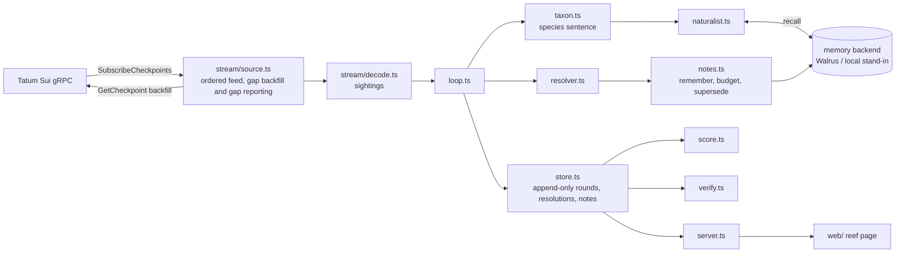

# Architecture

Regenerated from the code at HEAD.

## Data flow

## Modules

| File | Role |
|---|---|
| `src/stream/client.ts` | gRPC clients for `SubscriptionService` and `LedgerService`; Tatum or public fullnode endpoint, `x-api-key` metadata |
| `src/stream/source.ts` | ordered checkpoint feed: reconnect, resume from last sequence, `GetCheckpoint` gap backfill, gap reporting |
| `src/stream/decode.ts` | balance changes → sightings above the per-coin size threshold |
| `src/taxon.ts` | deterministic species sentence from traits (no LLM) |
| `src/naturalist.ts` | `recall`, distance-weighted vote, shrink toward the base rate, abstain when evidence is thin |
| `src/baselines.ts` | base-rate and per-address frequency predictions logged on the same round |
| `src/resolver.ts` | did the sender move again within H minutes; void on a checkpoint gap |
| `src/notes.ts` | field-note text, daily write budget, superseding notes, retry ledger |
| `src/memory/` | one backend interface: `memwal.ts` (Walrus Memory) and a local stand-in used before credentials exist |
| `src/store.ts` | crash-safe append-only files under `data/live/` |
| `src/score.ts` | Brier scorecards per stream × memory backend, never-seen subset, per-day curve |
| `src/verify.ts` | offline invariants I1–I3 and on-chain re-derivation of sampled rounds |
| `src/server.ts` | `/events` SSE, `/api/rounds`, `/api/score`, `/api/notes`, `/api/health`, `/rounds.csv`, `/integrations/verify` |
| `src/logger.ts` | the long-lived process; re-checks credentials every 60 s and hot-switches to Tatum / Walrus |
| `web/` | reef page: canvas reef, call card, notebook, how-it-works; replay mode from `web/public/data/snapshot.json` |

## Invariants

- **I1** a round's three predictions (memory, base rate, frequency) are written at call time; the resolution is a
  second record keyed by round id.
- **I2** an outcome is a pure function of the checkpoints after the sighting; `pnpm verify` re-derives it from
  `GetCheckpoint` / `GetTransaction`.
- **I3** every note a call cites was written before the call.

## Source labelling

Every round carries `network_source` (`tatum` or `public-dev`) and a memory backend (`walrus`, `local-dev`, or `none` when no memory is configured). The
scorer builds its headline only from `tatum` × `walrus` rows and prints every other combination under a development
label.
