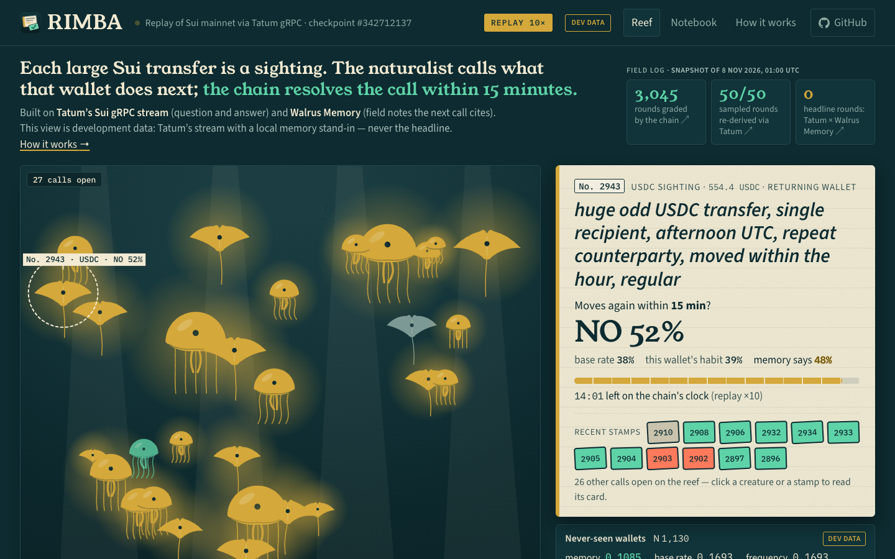
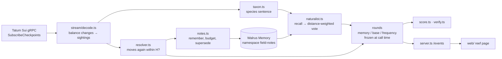

<div align="center">
  
  <h1>RIMBA 🪼</h1>
  <p><em>A naturalist agent built on Tatum's Sui gRPC stream and Walrus Memory: it calls what big Sui wallets do next and lets the chain grade its calls.</em></p>
  

  <br/>

  [](https://rimba-five.vercel.app)
  [](https://tatum.io/hackathon/total-recall)

  <br/>

  
  
  
  
  [](https://opensource.org/licenses/MIT)
  [](https://github.com/edycutjong/rimba/actions/workflows/ci.yml)

</div>

---

**Track 1 — Markets & Sports Prediction · Best Walrus Memory.** RIMBA is a forecaster for on-chain flow: each call is a
dated yes/no forecast ("does this wallet move again within 15 minutes?"), frozen before the answer exists, graded by
the chain and scored by Brier against the base rate and the wallet's own habit.

> **Read this first.** RIMBA scores itself, and it only counts a round toward its headline if the checkpoint arrived
> through **Tatum's Sui gRPC** *and* the recall came from **Walrus Memory**. At the 7 Nov early freeze (15:32 UTC) that
> headline had **0 rounds**: every round before it ran on Sui's public fullnode with a local stand-in for memory (the
> first 15 with no memory at all). At 15:39 UTC the Tatum key went live and the logger switched itself to the Tatum
> gateway; new rows are tagged `tatum`, and `pnpm verify` through the gateway re-derived 9 of 9 sightings and 9 of 9
> outcomes of the first Tatum-streamed rounds ([`evidence/verify-tatum-2026-11-07.md`](evidence/verify-tatum-2026-11-07.md)).
> Memory is still the local stand-in until the Walrus Memory delegate key exists, so the headline is still 0. Stand-in
> rows are labelled "Dev data" in the reef page and `DEV DATA` in this README and are never presented as the result.
> See [Scorecard](#-scorecard-and-what-it-does-not-claim-yet).

## 📸 See it in Action

<p align="center"></p>

The animated banner above replays one real logged call (No. 0409: 699.94 SUI, `YES · 72%`, resolved at checkpoint
342451091, outcome written as note No.0218). It ran on development data (public fullnode + local memory stand-in) and
illustrates the loop; it is not a scorecard figure.

The [live reef](https://rimba-five.vercel.app) replays a committed snapshot of real Sui mainnet sightings at 10× speed
(badge `REPLAY`); run the logger and server locally and the same page switches to `LIVE` over server-sent events.
Each jellyfish (SUI), ray (USDC) or fish (other coin) is a large transfer. The card on the right is one call: the
species sentence, `YES/NO/ABSTAIN` with a probability, the base rate and the wallet's own habit beside it, the countdown
on the chain's clock, and the field notes the call cited. Click a stamp to read how an earlier call resolved.

## 💡 The Problem & Solution

### The Problem
Big Sui wallets move many times a day. Watchers guess what each will do next, but nobody scores the guess, so neither
people nor bots learn whose read to trust. Where predictions are scored at all, resolution is often slow; on Sui a "what
happens next" question can resolve in minutes, straight from the chain.

### The Solution
For every large transfer the naturalist writes a **sighting**, turns it into a plain-words **species sentence**
(deterministic code, no LLM: size bucket, round or odd shape, number of recipients, time of day, new vs. repeat counterparty, the wallet's recent pace, how often the wallet was sighted before, coin), and **recalls**
similar field notes from Walrus Memory. It calls *"this wallet moves again within 15 minutes: yes / no"*, or abstains
when no note is close enough, and records which notes it cited. The stream itself resolves the call minutes later and
the outcome is written back as a new field note, so the next similar sighting can get a different call. Each round is
also scored against two opponents logged at the same instant: the global base rate and that address's own frequency.
The score is a Brier score (mean of `(p − outcome)²`; lower is better; always guessing 0.5 scores 0.25).

## 🏗️ Architecture & Tech Stack



| Layer | Choice |
|---|---|
| Runtime | Node 22, TypeScript, pnpm |
| Sui stream | `@grpc/grpc-js` + vendored `sui.rpc.v2` protos ([`proto/`](proto)) |
| Memory | `@mysten-incubation/memwal`, namespace `field-notes` |
| Local state | append-only rounds and notes under `data/live/` (crash-safe, greppable) |
| Web | Vite + canvas 2D, no framework; Vercel static host |
| Tests / CI | vitest, ESLint, `tsc`, GitHub Actions |

Details: [ARCHITECTURE.md](ARCHITECTURE.md).

## 🏆 Sponsor Integration — Tatum + Walrus Memory

**Tatum Sui gRPC** (`sui-mainnet-grpc.gateway.tatum.io:443`, TLS, `x-api-key` metadata) is the engine, not decoration.
Three methods of `sui.rpc.v2` carry the whole loop:

| Method | Used for | Code |
|---|---|---|
| `SubscriptionService/SubscribeCheckpoints` | the live feed every sighting comes from | [`src/stream/client.ts`](src/stream/client.ts), [`src/stream/source.ts`](src/stream/source.ts) |
| `LedgerService/GetCheckpoint` | gap backfill so no checkpoint is skipped; re-derives NO outcomes at the deadline | [`src/stream/source.ts`](src/stream/source.ts), [`scripts/verify.ts`](scripts/verify.ts) |
| `LedgerService/GetTransaction` | `pnpm verify` re-derives the sighting and each YES move from the chain | [`src/stream/client.ts`](src/stream/client.ts), [`scripts/verify.ts`](scripts/verify.ts) |

**Walrus Memory** (`@mysten-incubation/memwal`, relayer `relayer.memory.walrus.xyz`): `recall` with a semantic + recency
scoring blend and a `maxDistance` cut-off drives every call ([`src/naturalist.ts`](src/naturalist.ts),
[`src/memory/memwal.ts`](src/memory/memwal.ts)); `remember` writes outcomes as field notes (budget permitting, with a daily write
budget), and a species whose behaviour drifts gets a newer superseding note rather than a deletion
([`src/notes.ts`](src/notes.ts)). The memory sees only public chain data.

Both are behind one `CheckpointSource` / memory-backend interface, which is how the same code runs against the public
fullnode and a local stand-in before credentials exist; every row records its `network_source` and memory backend.

## 📊 Engineering Rigor

| Measure | Value | Reproduce |
|---|---|---|
| Tests | 94 passing, 13 files | `pnpm test` |
| Static checks | `tsc --noEmit`, ESLint, web `tsc` clean | `pnpm typecheck && pnpm lint` |
| Invariants I1–I3 | I1 a call is written before its resolution, one resolution per round; I2 an outcome is a pure function of later checkpoints; I3 every cited note predates the call | [`test/loop.test.ts`](test/loop.test.ts), [`test/naturalist.test.ts`](test/naturalist.test.ts), [`test/verify.test.ts`](test/verify.test.ts) |
| On-chain re-derivation | `pnpm verify` re-derives sampled sightings and outcomes from the chain; exit 0 only if all match | [`evidence/verify-2026-11-06.json`](evidence/verify-2026-11-06.json) |
| Benchmarks (6 Nov run, earlier question; the p50s are per-checkpoint and unaffected) | decode p50 0.012 ms per mainnet checkpoint; checkpoint → call written p50 887 ms (public node) | [`evidence/bench-2026-11-06.md`](evidence/bench-2026-11-06.md) |

### Attacks defeated

| Control | Why it is load-bearing | Test |
|---|---|---|
| Predictions are frozen when the call is written | the memory, base-rate and frequency predictions are logged on the same round before any outcome exists | [`test/loop.test.ts`](test/loop.test.ts) |
| Calls written more than 60 s after their checkpoint are excluded from the stream-labelled scorecards and the headline (they stay visible in the all-rows view) | a late call could have seen the outcome | [`test/score.test.ts`](test/score.test.ts) |
| Rounds resolved through a different stream than they were called on are excluded | mixing sources would blur the headline | [`test/score.test.ts`](test/score.test.ts) |
| Abstain when no note is within `maxDistance` | an uninformed call is reported as the base rate, not as skill | [`test/naturalist.test.ts`](test/naturalist.test.ts) |
| Checkpoint gaps void a round instead of resolving it NO | a missing checkpoint is not evidence of silence | [`test/resolver.test.ts`](test/resolver.test.ts) |

## ⛓️ Live Deployment

No wallet signing anywhere: RIMBA only reads the chain, and its code never submits a Sui transaction. The Walrus Memory SDK authenticates with a delegate key.

- Reef page: <https://rimba-five.vercel.app> (Vercel static, replay of [`web/public/data/snapshot.json`](web/public/data/snapshot.json); every resolved round under the current question is in [`web/public/data/rounds.csv`](web/public/data/rounds.csv): 2,394 rows at the 7 Nov early freeze, 2,379 of them with the local stand-in; open rounds are not included)
- Logger: runs continuously on the builder's machine (`pnpm logger`) and resolves each call on the chain's own clock.

## 🧮 Scorecard and what it does not claim yet

Question: does the sender move again within 15 minutes (any transfer)? Source of truth: [`evidence/score-2026-11-07.md`](evidence/score-2026-11-07.md), regenerated by `pnpm score --write`.

| Stream × memory | Rounds resolved | Status |
|---|---|---|
| Tatum gRPC × Walrus Memory (**headline**) | **0** | Walrus Memory key not wired yet (Tatum stream live since 7 Nov 15:39 UTC); no headline claimed |
| Sui public fullnode × local stand-in (**DEV DATA**) | 2,379 | development only, never a headline |

On the dev rows, for never-seen addresses (N = 1,118) the memory's Brier score is 0.1080 against 0.1691 for the base rate
(lower is better); across all 2,379 resolved rounds, 0.1417 against 0.2370 for the base rate and 0.1517 for the
per-address frequency table. The reef is a frozen snapshot of 400 sampled rounds of this ledger, taken at the early freeze
(7 Nov 2026 22:32 WIB, [`evidence/freeze-2026-11-07.md`](evidence/freeze-2026-11-07.md)); the figures above come from
`pnpm score` over the full ledger (filter `memory_source=local-dev`). The logger keeps running, so later `pnpm score` output will have larger N. That is a development-stream result with a local memory stand-in. It is consistent with the loop
learning on live mainnet traffic, nothing more. It does not say anything about Walrus Memory or Tatum.

**Limitations, stated plainly**
- "Moves again within 15 min" is partly a habit question; the per-address frequency table is a strong opponent on known
  addresses, which is why the headline is the never-seen subset.
- Per the Walrus Memory documentation the managed relayer sees plaintext notes; notes hold only public chain data.
- The horizon and size thresholds were chosen on development rows before any headline row existed
  ([`evidence/day0/`](evidence/day0), [`config/rimba.json`](config/rimba.json)). The Walrus abstain distance (0.35) is an
  initial value set before any Walrus Memory recall had run; it may be recalibrated with `scripts/calibrate.ts`, and any
  change will be stated here.
- Small samples: a few hundred rounds separate skill from luck only loosely. Read the N next to every number.

## 🚀 Getting Started

### Prerequisites
Node ≥ 22 and pnpm. A Tatum API key and a Walrus Memory delegate key are optional: without them the logger falls back
to the public fullnode and a local memory stand-in and tags every row accordingly.

### Installation
```bash
pnpm install
pnpm logger          # watch the stream, make and resolve calls (hot-switches to Tatum / Walrus when keys appear)
pnpm server          # serves /events (SSE) for the reef page; in another shell: pnpm --dir web dev
```
Credentials are read from `~/.config/tatum/tatum.env` (`TATUM_API_KEY`) and `~/.config/memwal/memwal.env`
(`MEMWAL_DELEGATE_KEY`, `MEMWAL_ACCOUNT_ID`, `MEMWAL_AGENT_ID`, `SUI_ADDRESS`), never from the repository.

## 🧪 Testing & CI

```bash
pnpm test && pnpm typecheck && pnpm lint   # 94 tests, type and lint clean
pnpm score --write                         # Brier scorecard → evidence/
pnpm verify                                # re-derive sampled outcomes from the chain
pnpm bench                                 # p50 / p95 numbers
```
CI ([`.github/workflows/ci.yml`](.github/workflows/ci.yml)) runs typecheck, lint, tests and the web build on every push;
CodeQL, gitleaks and Dependabot run alongside.

## 📁 Project Structure

```
src/stream/   Tatum gRPC client, checkpoint source with gap backfill, decoder
src/memory/   Walrus Memory backend + local stand-in behind one interface
src/          taxon (species sentence), naturalist (recall + vote), resolver, notes, score, verify, logger, server
scripts/      score, verify, bench, snapshot, day-0 measurement, spikes
web/          reef page (Vite + canvas)
evidence/     score, verify and bench output the numbers above come from
```

## 📄 License

[MIT](LICENSE)

## 🙏 Acknowledgments

Tatum for the Sui gRPC gateway and Walrus / Mysten Labs for Walrus Memory and the `sui.rpc.v2` protos.
